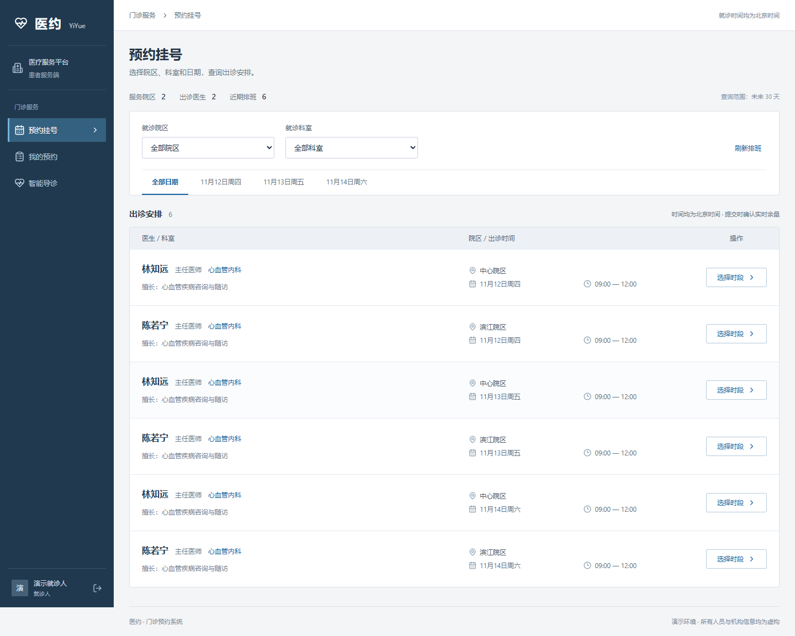

# 医约 YiYue

面向诊所与多院区医院的前后端分离预约平台。当前代码版本 **0.3.0：停诊、替诊与患者确认改约（本地完成，未发布）**，提供两种机构的虚构演示数据。

## 工程目录与独立运行

```text
D:\IDEA_WORK\yiyue\
├── yiyue-web/       Vue 3 前端工程，独立 package.json、Vite 和 Dockerfile
├── yiyue-server/    Java 21 后端工程，独立 pom.xml、Spring Boot 和 Dockerfile
├── scripts/         本机启停与 HTTP 冒烟脚本
├── docs/            架构、接口、配置和验证记录
└── compose.yml     可选的统一部署入口
```

两端通过 HTTP `/api` 通信。前端开发服务默认5173，后端默认8080；本机启停脚本使用15173和18080以避开已有程序。前端由 Vite 或 Nginx 代理 API，Java 不打包或托管前端页面。

IDEA 导入 `yiyue-server/pom.xml` 后可独立运行 `com.yiyue.YiYueApplication`。前端在 `yiyue-web` 中独立安装依赖并运行 `npm run dev`。数据库、Redis 及端口配置见下面的开发说明。

## 开发维护入口

后续开发先阅读根 `AGENTS.md`、`docs/roadmap.md`、`docs/project-structure.md` 和 `CHANGELOG.md`。路线已细分版本、任务编号、依赖与验收标准；当前v0.3.0停诊、替诊与改约已完成本地验证；AI实网待评估，详见docs/v0.3.0.md。

## 技术选型

| 层次 | 技术 |
|---|---|
| 后端 | Java 21、Spring Boot 3.5.7、Spring Security、MyBatis-Plus 3.5.14 |
| 数据 | PostgreSQL 17、Flyway、Redis / Spring Session |
| 前端 | Vue 3、TypeScript、Vite、Lucide |
| 验证与交付 | JUnit、MockMvc、真实 PostgreSQL 集成测试、Vitest、Docker Compose、GitHub Actions |

采用模块化单体，模块为 auth、scheduling、booking、domain、mapper、common、config。第一版事务跨号源和预约，保留单库事务；尚无独立扩容与独立发布需求，因此暂不引入 Spring Cloud、MQ 或分布式事务。

## 已实现

- 机构编码登录；患者 / 管理员权限；Redis 会话；CSRF 防护与 HttpOnly Cookie。
- 医院多院区 / 诊所单门店演示；科室、医生、院区查询与筛选。
- 管理员发布排班并生成分时段号源，同一医生跨院区时间冲突校验。
- 患者预约、幂等重试、取消；数据库原子容量控制、部分唯一索引防重复预约。
- 管理员办理签到、完成接诊；预约记录按页查询并显示医生、院区、就诊时间。
- 预约与状态变更审计。容量变化和预约状态共用数据库事务。
- 桌面和移动端布局；蓝白配色、紧凑排班列表、加载及失败反馈。
- DeepSeek 智能导诊：症状输入、同意确认、当前机构科室匹配、补充问题、就医提示和排班跳转。默认关闭，需本地 API Key。

## Windows 本机启动（PowerShell 7）

本机脚本使用独立数据目录 `.local/postgres`，默认 PostgreSQL 55433、Redis 56379、后端 18080、前端 15173。不会操作系统已有数据库。

```powershell
# 首次安装前端依赖，并构建后端；本地凭证由启动脚本随机生成。
Set-Location D:\IDEA_WORK\yiyue\yiyue-web
npm.cmd ci
Set-Location ..\yiyue-server
mvn -B -DskipTests package
Set-Location ..
.\scripts\Start-Local.ps1
```

脚本默认读取当前机器 `D:\software\PostgreSQL\17\bin` 和 `D:\software\redis\redis-server.exe`。其他机器可通过 `-PostgresBin`、`-RedisServer` 参数指定路径；端口也可通过 `-PostgresPort`、`-RedisPort`、`-ServerPort`、`-WebPort` 修改。

打开 <http://127.0.0.1:15173>。机构选择 `hospital`（医院）或 `clinic`（诊所）；账号 `patient` / `admin`；密码在项目根目录 `.env` 的 `DEMO_PATIENT_PASSWORD` / `DEMO_ADMIN_PASSWORD`，不要上传该文件。两个机构演示账号相互独立。首次启动为未来三天创建排班，已有机构不会重新种数据，后续可由管理员继续发布排班。

停止：`.\scripts\Stop-Local.ps1`。日志和进程标识保存在 `.local/`，数据停止后保留。代码变更后先停止，再重新构建后端并启动。

## Docker Compose

```powershell
# 如 .env 已存在，跳过生成步骤，保留原配置。
.\scripts\Setup-Env.ps1
docker compose up --build -d
```

打开 <http://localhost:8090>，Nginx 将 `/api` 转发到后端。Docker 的 PostgreSQL 映射 55432，Redis 映射 56379，不要与本机方案同时占用同一端口。Docker 方案已经提供配置，但本次环境无 Docker，尚未实机验证容器构建。

## IDEA 开发

打开根目录，再将 `yiyue-server/pom.xml` 导入 Maven，Project SDK 选 Java 21。运行 `YiYueApplication` 前设置：`DB_URL`、`DB_USERNAME`、`DB_PASSWORD`、`REDIS_HOST`、`REDIS_PORT`、`REDIS_PASSWORD`。需要演示数据时再设置 `DEMO_ENABLED=true` 和两个至少 12 位的演示密码。

Vite 默认代理后端 8080；后端使用其他端口时，先设置 `API_PROXY_TARGET`。例如 `$env:API_PROXY_TARGET='http://127.0.0.1:18080'`，再在 yiyue-web 运行 `npm.cmd run dev`。Vite 只向客户端暴露 `VITE_` 前缀变量，不要用该前缀存放服务端凭证。

## 验证

集成测试必须连接**独立测试库**，不允许使用实际业务库。测试会插入全虚构的数据，不自动清空数据库；每次生成独立机构编码。

```powershell
# 通过环境变量指向专用 PostgreSQL 测试库，下面只展示配置变量名。
$env:TEST_DB_URL = 'jdbc:postgresql://127.0.0.1:55432/yiyue_test'
$env:TEST_DB_USERNAME = 'yiyue_test'
# TEST_DB_PASSWORD 由本地环境提供，不写入源码。
Set-Location yiyue-server
mvn -B verify
mvn spotless:check
Set-Location ..\yiyue-web
npm.cmd test
npm.cmd run build
```

默认测试配置面向 55432 的 `yiyue_test`，CI 使用临时 PostgreSQL 服务，单元/接口集成测试通过 test profile 使用内存 HttpSession；Redis 实际会话另用 HTTP 冒烟验证。格式化：后端 `mvn spotless:apply`；前端 `npm run format`。

HTTP 冒烟验证：服务启动后在项目根目录运行 `python scripts/smoke.py`（仅使用虚构演示数据）。

详见 `docs/architecture.md`、`docs/api.md`、`docs/ai-triage.md`、`docs/verification.md` 和 `docs/roadmap.md`。



## 当前边界

当前支持的组织规模通过模型和虚构场景验证，尚未证明“大医院生产级”性能。支持授权就诊人代预约及管理员/前台/医生/平台管理员独立岗位。已具备机构开户及医生、就诊人档案维护；支付、候补、停诊改约、通知投递、设备联合预约尚未实现。暂未接入 HIS、医保、短信或真实支付；无真实患者数据。

上线前需按具体机构要求完成 HTTPS、安全加固、登录限流、凭证托管、备份恢复及医疗信息系统对接验证；示例配置只面向本机开发。

## 启用 DeepSeek 导诊

在本地 `.env` 设置 `AI_ENABLED=true`，填写 `DEEPSEEK_API_KEY`，并配置 `DEEPSEEK_MODEL`（默认 `deepseek-flash`），再通过启停脚本重启服务。密钥不进入前端。具体请求格式、数据处理、测试方法和未验证部分见 `docs/ai-triage.md`。缺少 Key 时展示真实的未启用状态，不使用模拟回答替代模型。

浏览器回归：服务启动后，在 yiyue-web 运行 `npx playwright install chromium`、`npm run test:e2e`。该测试只模拟 AI 返回，不对外发送症状，真实模型效果尚未验证。

## v0.2.0入口

后端父POM下为yiyue-common、yiyue-ai、yiyue-application。IDEA从父POM导入，运行application中的YiYueApplication。执行mvn -f yiyue-server/pom.xml verify构建全模块，-pl yiyue-ai -am test可独立验证AI。

管理员进入基础运营，患者进入就诊人管理。新机构可在登录页直接输入机构编码。平台账号首次需在本地.env显式设置PLATFORM_ADMIN_ENABLED=true及随机PLATFORM_ADMIN_PASSWORD后重启，机构编码platform、账号platform_admin；默认关闭，不提升普通管理员权限。详见docs/v0.2.0.md。

## v0.3.0 入口

机构管理员在“排班与号源”选择“排班变更”，填写原因并选择停诊或替诊。提交后在“排班变更”查看影响清单、处理进度、失败重试，也可为单个预约提供同院区同科室的改约建议。患者进入“变更通知”，查看原预约取消结果，选择新时段并勾选同意后改约，或拒绝建议。

新号源不会提前保留；确认时校验实时容量。当前通知只在系统内展示，短信/outbox属于v0.4.0。详见 `docs/v0.3.0.md`。
