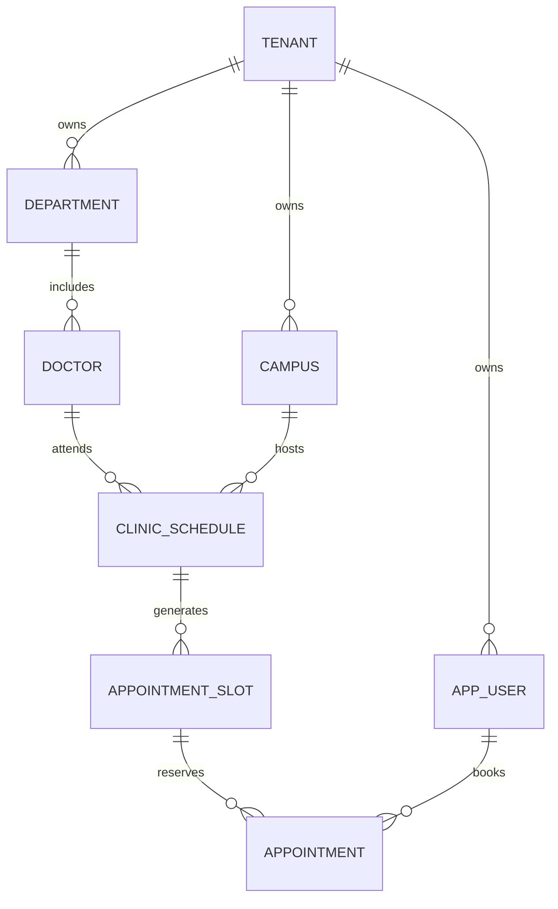

# 架构与关键取舍

## 请求链

Vue → 同源 `/api` 代理 → Spring Security / CSRF → Controller 参数验证 → Service 机构与业务校验 → MyBatis-Plus / 固定 XML → PostgreSQL。
Redis 保存会话和 CSRF 所属会话；容量的最终依据始终是 PostgreSQL，Redis 故障时会话服务不可用，不降级为跳过认证。

## 数据模型

业务状态、范围和排班关系由应用层校验。数据库使用主键、外键、非空、唯一索引，不新增 CHECK 约束。预约状态为 BOOKED → CHECKED_IN → COMPLETED，另有 BOOKED → CANCELLED。完成接诊不释放历史时段占用，只有取消释放。

时间统一为机构北京时间，数据库使用不带时区 TIMESTAMP，API 使用 ISO 本地时间。这适合当前国内场景；跨时区业务需要显式扩展机构时区，不能直接把本地时间当作 UTC。

## 并发与一致性

1. 排班创建先锁医生行，再检查半开区间 `[start,end)` 是否重叠，最后写排班和号源。相邻时段允许，不同院区仍共用同一个医生身份。
2. 预约通过 `reserved < capacity` 条件原子自增，与预约插入和审计写入同一事务，插入失败回滚容量。
3. `(tenant,user,requestKey)` 唯一约束防重试重复写入；相同 key 换 slot 返回冲突。并发同 key 的后到请求可能收到 409，使用同 key 重试可取得已存在预约。
4. 部分唯一索引阻止同一账号同一时段重复的非取消预约。当前尚不禁止不同号源时间交叠的预约。
5. 取消先按 BOOKED 条件更新预约，成功后只释放一次容量，整体事务。签到与取消并发时只有一次原状态迁移成功。
6. 所有客户端可达读取和更新按 SessionUser 中的 tenantId 筛选；患者操作额外验证 userId。租户身份来自服务端会话，不接受前端传入 tenantId。

XML 仅包含无法用普通 MP CRUD 自然表达的容量原子更新、医生行锁，无注解 SQL、无外部输入 SQL 拼接。关联查询在 Service 按页批量读取组装。预约每页 20 条；排班列表当前窗口为未来 30 天，后续大量排班场景需要服务端筛选分页。

## 安全与扩展边界

BCrypt 保存密码；登录轮换会话 ID；Redis 会话 Cookie 为 HttpOnly + SameSite=Lax；写请求必须携带会话 CSRF token。公开健康接口只输出聚合健康状态。登录使用统一错误消息，数据库冲突不暴露 SQL。当前登录端点尚无速率限制。

医院和诊所共用模型，通过租户隔离和不同资源/容量配置区分，不复制两套业务。尚未抽象通用预约引擎或提前拆微服务。未来支付和通知可在独立业务需求出现后加入 outbox 与后台任务。

## 智能导诊模块

新增 `triage` 模块复用已有 SessionUser、机构科室 Mapper、CSRF 和统一异常。使用 Spring RestClient 调用 DeepSeek，未新增生产依赖。科室是本机构数据库白名单，模型只能返回分类ID、紧急性枚举、固定追问枚举。模型原始文本不直接展示；仅给匹配参考，无诊断或治疗能力。Redis 原子限流与业务会话使用不同命名空间。完整说明与来源见 `ai-triage.md`。

## v0.1.1 工程分层

代码组织已调整为 controller、service/impl、mapper、model/entity/req/resp；旧 booking/scheduling 包的业务已迁到服务实现。triage 包保留外部调用基础设施。以 project-structure.md 为当前目录说明；既有容量、事务、安全和状态设计仍然适用。

## v0.2.0当前结构

后端已拆为Maven三模块，历史单模块描述以project-structure.md为当前说明。预约防重改为就诊人维度，容量仍由PostgreSQL原子控制。

## v0.3.0 排班变更一致性

排班状态 OPEN → STOPPED。创建变更时先锁机构行，关闭原排班并快照 BOOKED 预约；有签到记录或排班已开始时拒绝。预约、取消、签到和变更共用机构行锁，防止创建影响清单后又插入新预约。随后仍使用原有档案锁、医生锁和容量原子 SQL。机构行锁会串行化同机构写操作，是当前版本保证一致性的保守取舍；大医院吞吐需要后续压测及更细粒度锁设计，当前不作生产规模承诺。

schedule_change 与 schedule_change_item 是持久化任务。每轮最多10任务、每任务20条；单条事务包含取消、容量释放、条目完成和审计。错误时先回滚，再独立事务记录安全错误摘要，3次失败转 FAILED，管理员可显式重试。轮询不依赖进程内队列；进程崩溃后已提交项不重做、未提交项仍待处理。当前测试覆盖数据库保存后重建轮询器，未做操作系统强杀故障注入。

替诊新建同时间的替代医生排班；原预约仍逐单取消。机构可另外建议同院区同科室的未来开放排班。患者确认时再次校验所有权、档案授权、目标状态和容量，使用 change-{条目ID} 幂等键在同一事务中创建新预约并记录决定。建议不占号，患者可拒绝；任务 DONE 表示原预约处理完成，患者决定独立记录，不代表患者已改约。

目前管理员与患者均显示最近100个任务/通知；单任务影响清单整体加载。未来大量数据需分页与批量查询优化。系统内通知不代表短信已送达，可靠外部通知属于v0.4.0。

## v0.4.0 候补与通知

slot.reserved同时包含正式预约和候补OFFERED保留。加入候补要求号源已满，唯一索引限制同就诊人同号源活跃条目。WAITING按ID先后获得保留；取消预约释放容量后，在同一事务内优先分配给候补。普通预约也先处理该时段候补，不能抢走保留。OFFERED确认时直接将保留转预约，不再reserve；幂等重复确认返回原预约。

保留期限为分配后10分钟与时段开始时间的较早值。退出、超时、停诊终止仅释放一次；确认时再次校验档案授权、账号与排班。沿用机构行锁→档案锁，保持v0.3.0一致性取舍。后台每5秒扫描200条活跃记录，按号源去重；游标轮转避免早期长队列使后续时段永远得不到处理。游标仅用于扫描公平性，重启从头扫描，业务状态保存在数据库。

候补状态变动和notification_event同事务写入；轮询每批100条，写inbox_message与delivered标志同事务提交。event_key、收件箱event_id唯一保证防重。单条失败回滚并保留待投递，记录事件ID/异常类型的安全日志，继续其他条目并在后续轮询重试。没有短信或邮件，不声称外部送达。

列表最近100条，候补详情当前按条组装；每号源队列整体读取，机构锁串行写入。大规模数据仍需分页、批量查询和压测优化。当前不含人工通知死信控制台、外部渠道、保留提前提醒或支付；不视作医院生产就绪。

## v0.5.0 模拟支付与占号

排班fee_cents=0沿用免费预约，正数为模拟收费。价格仅在发布时设置，订单持有价格快照，前端不提交价格。PENDING订单占用reserved，截止时间为创建后15分钟与时段开始时间的较早值。普通预约入口拒绝收费排班，避免绕过订单。

付款演示接口要求患者会话、CSRF和明确同意，不是外部支付回调。mock_payment_receipt模拟渠道流水，唯一order_id/transaction_key防重；确认与超时任务共用机构行锁。有效付款把既有保留转为预约，不再次占容量；迟到、已关闭、停诊或授权失效只登记REFUND_PENDING，不新建预约。后台每5秒扫描100个到期/退款任务，模拟退款流水和REFUNDED状态同事务；故障回滚，任务持久化后继续重试。

取消收费预约和停诊逐单取消会在原事务登记退款任务；停诊立即关闭并释放待支付订单。对账读取最近200单，对比模拟流水金额、存在性和退款标记，不等同真实渠道账单。金额以分计，发布范围0～1000000分由应用层校验，无数据库CHECK。

收费候补和收费建议一键改约尚未接入支付保留转换，明确拒绝绕过收费。免费候补/改约兼容；收费改约需重新选时段创建订单，旧单退款。PaymentService只依赖Mapper和档案服务，原预约/停诊服务调用其退款入口，不引入循环依赖。

压测数据扩大后发现患者变更通知旧实现加载全部预约再拼IN，超过数据库绑定参数规模。现改为单JOIN XML按tenant/user过滤、显式resultMap，由MP分页插件限制最近100条；保留十万历史数据做真实浏览器回归。

## v0.6.0 排班联合资源

clinic_resource维护同机构同院区的ROOM/EQUIPMENT档案；schedule_resource记录整场排班的半开区间[start,end)独占。患者在排班内按原容量预约，资源不是逐人占用的设备检查单。发布排班可选最多20个互不重复资源；按tenant锁→doctor锁→资源ID排序校验，沿用机构行锁串行写入，没有新增跨进程内存锁。

原ScheduleService事务同时写医生排班、资源占用和号源，任一失败全部回滚。停诊释放资源；替诊在同一外层事务先释放原资源再创建替代排班并继承资源与价格，失败回滚恢复原状态。相邻区间可共用资源。正在进行或未来仍有ACTIVE占用的资源不可编辑/停用，跨机构/院区资源不允许绑定。历史记录保留RELEASED，不删除审计或资源占用。

兼容无resourceIds的原请求；旧Java构造重载保留。资源列表目前整体加载，使用机构锁保证一致性，不作医院级吞吐承诺。没有设备检修日历、资源数量池、单人检查任务或资源使用完成上报，本版仅覆盖整场排班资源预订。

## v0.7.0 安全及恢复边界

登录计数使用Redis原子窗口，失败关闭，不信任外部转发头。production只启用TLS并要求环境注入证书密码，关闭模拟支付和收费发布，前端按认证能力接口同步入口；不会自动把演示库转换为生产库。备份以新库恢复、表内容指纹及业务不变量校验，不覆盖原库。详见v0.7.0.md及verification原始结果；HIS/FHIR没有真实对接。
