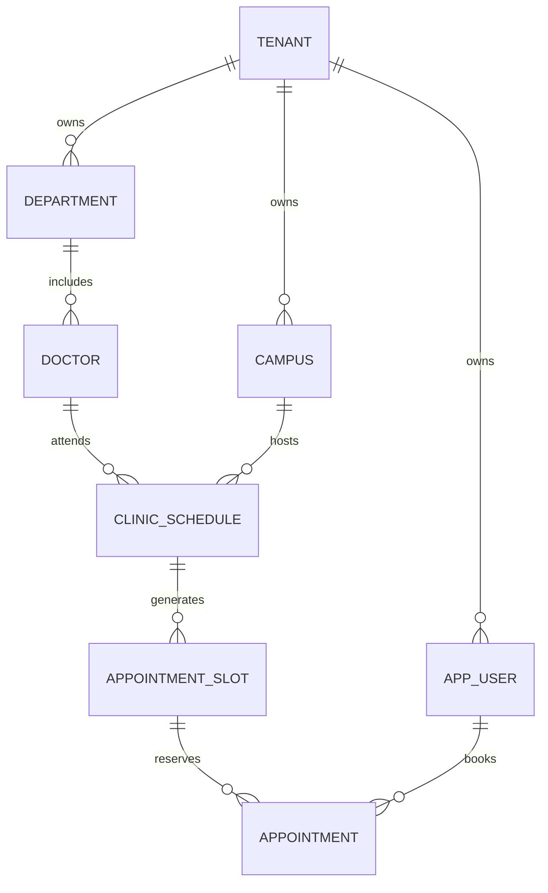

# 架构与关键取舍

## 请求链

Vue → 同源 `/api` 代理 → Spring Security / CSRF → Controller 参数验证 → Service 机构与业务校验 → MyBatis-Plus / 固定 XML → PostgreSQL。
Redis 保存会话和 CSRF 所属会话；容量的最终依据始终是 PostgreSQL，Redis 故障时会话服务不可用，不降级为跳过认证。

## 数据模型

业务状态、范围和排班关系由应用层校验。数据库使用主键、外键、非空、唯一索引，不新增 CHECK 约束。预约状态为 BOOKED → CHECKED_IN → COMPLETED，另有 BOOKED → CANCELLED。完成接诊不释放历史时段占用，只有取消释放。

时间统一为机构北京时间，数据库使用不带时区 TIMESTAMP，API 使用 ISO 本地时间。这适合当前国内场景；跨时区业务需要显式扩展机构时区，不能直接把本地时间当作 UTC。

## 并发与一致性

1. 排班创建先锁医生行，再检查半开区间 `[start,end)` 是否重叠，最后写排班和号源。相邻时段允许，不同院区仍共用同一个医生身份。
2. 预约通过 `reserved < capacity` 条件原子自增，与预约插入和审计写入同一事务，插入失败回滚容量。
3. `(tenant,user,requestKey)` 唯一约束防重试重复写入；相同 key 换 slot 返回冲突。并发同 key 的后到请求可能收到 409，使用同 key 重试可取得已存在预约。
4. 部分唯一索引阻止同一账号同一时段重复的非取消预约。当前尚不禁止不同号源时间交叠的预约。
5. 取消先按 BOOKED 条件更新预约，成功后只释放一次容量，整体事务。签到与取消并发时只有一次原状态迁移成功。
6. 所有客户端可达读取和更新按 SessionUser 中的 tenantId 筛选；患者操作额外验证 userId。租户身份来自服务端会话，不接受前端传入 tenantId。

XML 仅包含无法用普通 MP CRUD 自然表达的容量原子更新、医生行锁，无注解 SQL、无外部输入 SQL 拼接。关联查询在 Service 按页批量读取组装。预约每页 20 条；排班列表当前窗口为未来 30 天，后续大量排班场景需要服务端筛选分页。

## 安全与扩展边界

BCrypt 保存密码；登录轮换会话 ID；Redis 会话 Cookie 为 HttpOnly + SameSite=Lax；写请求必须携带会话 CSRF token。公开健康接口只输出聚合健康状态。登录使用统一错误消息，数据库冲突不暴露 SQL。当前登录端点尚无速率限制。

医院和诊所共用模型，通过租户隔离和不同资源/容量配置区分，不复制两套业务。尚未抽象通用预约引擎或提前拆微服务。未来支付和通知可在独立业务需求出现后加入 outbox 与后台任务。

## 智能导诊模块

新增 `triage` 模块复用已有 SessionUser、机构科室 Mapper、CSRF 和统一异常。使用 Spring RestClient 调用 DeepSeek，未新增生产依赖。科室是本机构数据库白名单，模型只能返回分类ID、紧急性枚举、固定追问枚举。模型原始文本不直接展示；仅给匹配参考，无诊断或治疗能力。Redis 原子限流与业务会话使用不同命名空间。完整说明与来源见 `ai-triage.md`。

## v0.1.1 工程分层

代码组织已调整为 controller、service/impl、mapper、model/entity/req/resp；旧 booking/scheduling 包的业务已迁到服务实现。triage 包保留外部调用基础设施。以 project-structure.md 为当前目录说明；既有容量、事务、安全和状态设计仍然适用。

## v0.2.0当前结构

后端已拆为Maven三模块，历史单模块描述以project-structure.md为当前说明。预约防重改为就诊人维度，容量仍由PostgreSQL原子控制。
